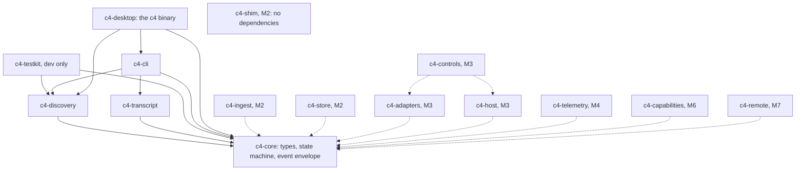
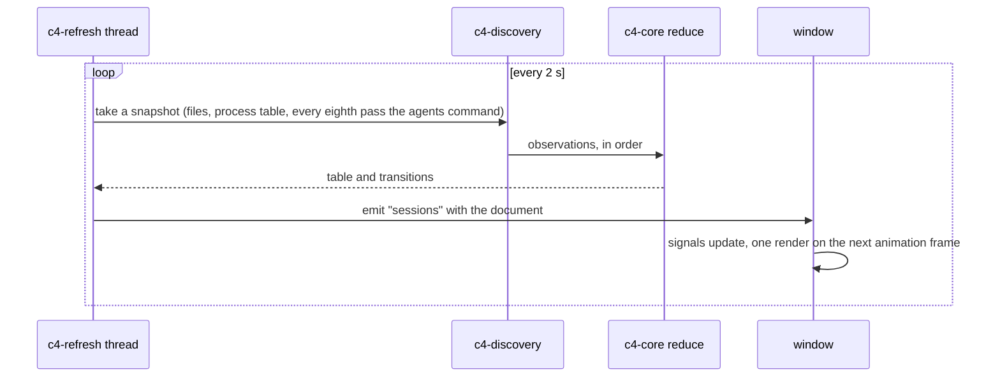
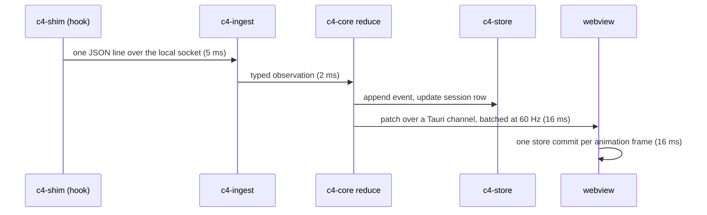
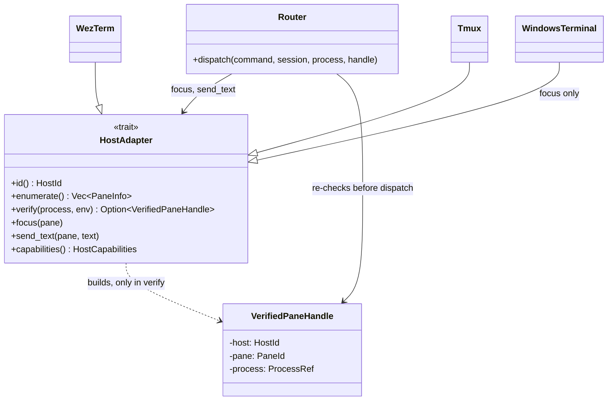

<!-- <wtl> project: c4 | file: docs/ARCHITECTURE.md | author: watchthelight </wtl> -->

# Architecture

C4 is a Rust core with a Tauri 2 shell. The core discovers sessions, tails transcripts, ingests hook
and status line payloads, reduces everything into typed session views and persists them in SQLite. The
shell renders those views with vanilla TypeScript and hosts xterm.js panes whose bytes come straight
from a per-session host process.

Status: Milestone 1 delivers `c4-core`, `c4-discovery`, `c4-transcript` (tailer, parser, follower,
index and watcher), `c4-testkit`, `c4-cli` and `c4-desktop`, whose window lists sessions. The other
crates are named below with the milestone that brings them; solid edges in the crate graph are in the
tree, dotted ones are planned.

## Processes

| Process | Role | Since |
|---|---|---|
| `c4` | The desktop app. With no arguments it opens the window; with arguments it runs a headless command (`sessions`, `doctor`, `telemetry` today; `perf`, `install`, `uninstall` and `host` with their milestones) and exits before any webview exists. | 1 |
| `c4-cli` | The same commands as a webview-free executable for development (`cargo run -p c4-cli -- sessions`). Not shipped. | 1 |
| `c4-shim` | A standard-library-only sidecar. `c4-shim statusline -- <original command>` copies stdin to C4's local socket (20 ms connect timeout, spool to disk on failure) and then runs the original command with the same stdin, passing its output and exit code through. `c4-shim hook` does the same tee and always exits 0 with empty output. About 2 ms of overhead. | 2 |
| `c4 host --session <id>` | One detached process per managed session. It owns the pty, a 2 MiB raw ring buffer, a screen model, the controller lease and a local socket. The UI can crash or exit and the host keeps the session alive. | 3 |
| `python -I hooks/c4_usage.py` | On demand: imports the user's `statusline.py` and prints its `parse_usage()` result as JSON for sessions whose status line has not run recently. | 4 |

## Crates



| Crate | Responsibility | Milestone |
|---|---|---|
| `c4-core` | `SessionId`, `ProcessRef {pid, proc_start}`, `Evidence {source, observed or heuristic, at}`, the nine-state `SessionState`, `Observation` (registry, agents command, daemon, process, transcript, hook, OSC), `SessionView`, `SessionTable`, `reduce` with its rules, the versioned event `Envelope`, `redact`. No I/O. | 1 |
| `c4-discovery` | `ClaudeHome` resolution (`C4_CLAUDE_HOME`, `CLAUDE_CONFIG_DIR`, `~/.claude`), the registry reader, the `claude agents --json` runner with a timed capture, daemon and job enrichment with the auth fields dropped, the process probe (sysinfo) with the liveness ladder (pid, creation time, executable name), terminal host identification from the process environment, the transcript existence check, and `Discovery`, which folds one pass into the table and reports the transitions. | 1 |
| `c4-transcript` | The byte-offset tailer, the tolerant record parser gated on the major `version`, the record-to-event map, the subagent and workflow directory scanner, the project index built from metadata only, `SessionFollower` (one session's main transcript and agent files, folded into observations, usage max-merged per message id) and the file watcher. The workflow graph comes in Milestone 5. | 1 (reader), 5 (graph) |
| `c4-testkit` | `ScratchHome` (a Claude home in a temp dir, seeded from `fixtures/home`), `FakeClaude` (a real process registered with its pid and creation time, so liveness tests run on a real process table), the discovery tests A and B. | 1 |
| `c4-cli` | `c4 sessions [--json|--watch|--files-only|--redact|--home]`, `c4 doctor [--json|--no-commands]`, `c4 telemetry --transcript <file> [--json]`. JSON output carries `schema: 1`. Exit 0, 1 (could not do the job, reason on stderr) or 2 (usage). | 1 |
| `c4-desktop` | The Tauri app: the refresh thread, two commands, one event, the Windows console attach for headless use. The window itself is `apps/desktop/src`. | 1 |
| `c4-ingest` | Local socket server (named pipe with a current-user DACL on Windows, mode 0600 Unix socket elsewhere), spool replay, bounded queues that drop the oldest item and count drops instead of blocking a producer. | 2 |
| `c4-store` | SQLite schema and queries: sessions, identities, events, cursors, usage samples, agents, tasks, config transactions, audit, hosts, layouts, searchable scrollback. | 2 |
| `c4-shim` | The sidecar. | 2 |
| `c4-adapters` | The `HostAdapter` trait and one implementation per terminal host. | 3, 7 |
| `c4-host` | The managed session host: pty, ring buffer, screen model, lease, socket framing. | 3 |
| `c4-controls` | The command router: target validation, leases, the audit log. | 3 |
| `c4-telemetry` | Status line payload ingest, the status line's cache file readers, cost and ledger readers, the quota model with explicit unknowns, the `c4_usage.py` bridge. | 4 |
| `c4-capabilities` | The library model, toolkits, config transactions with backups and inverse operations, redaction. | 6 |
| `c4-remote` | Pairing and an encrypted transport for paired hosts. Off by default. | 7 |

## The desktop app

`apps/desktop/src-tauri` is the `c4-desktop` crate and builds the `c4` executable. `main.rs` looks at
the command line first: any argument means a headless command, so it attaches to the parent console
on Windows (a release `c4` is a windowed executable) and hands over to `c4_cli::main()`, and no
webview is ever created. With no arguments `c4_desktop::run()` builds the Tauri app.

The app state is one `Discovery` behind a mutex, shared by the refresh thread and the commands. The
refresh thread (`c4-refresh`) runs a pass every `C4_REFRESH_MS` milliseconds (2000 by default, floor
250): the registry files, the daemon files, the process table and the transcript check. Every eighth
pass also runs the session list command, because it starts a Node process and, on macOS and Linux, can
revive Claude Code's background supervisor as a side effect. After each pass the thread emits the
`sessions` event with the document below. The mutex serializes a pass with a `list_sessions` call, so
the table is never read half-updated.

| Call | Direction | Payload |
|---|---|---|
| `list_sessions` | window to core (invoke) | runs one files-only pass and returns the document |
| `about` | window to core (invoke) | C4 version, the Claude home and what chose it, refresh period, agents cadence, operating system |
| `sessions` | core to window (event) | the document, after every pass |

The document is what `c4 sessions --json` prints (`schema`, `at`, `home`, `sessions[]`, `report`)
plus `tick` (the pass counter), `agents` (when the session list command last ran, how many entries it
returned or why it failed) and `transitions[]` (session, from, to, the state text and the evidence of
every state change in the pass). `apps/desktop/src/bridge/types.ts` mirrors every shape.

The window is TypeScript without a framework. Four signals (`snapshot`, `about`, `selected`, a
one-second `clock`) feed one render per animation frame; nothing renders while the window is hidden.
`selectBridge()` picks the Tauri bridge when the page runs inside the app and the mock bridge (eight
synthetic sessions on a scripted timeline) in a plain browser, so the layout can be worked on and
tested without Claude Code; `VITE_C4_BRIDGE=mock|tauri` forces either. `fixtures/labels.json` is the
label contract: the Rust side and the TypeScript side are both tested against it, so the window never
shows a state label the command line would contradict.

Capabilities: the window runs with Tauri's `core:default` capability only; the two commands above are
the whole surface. The content security policy allows `self` and inline styles and nothing remote.

## Event flow

Today:



From Milestone 2, hook and status line payloads join through the shim and the ingest socket:



Budget from hook event to pixels: 150 ms at the 95th percentile. Terminal bytes (Milestone 3) do not
take this path. The host coalesces pty output into frames of at most 64 KiB every 8 to 16 ms, allows
two frames in flight per terminal, and sends them as raw bytes over a Tauri channel straight to
`xterm.write`. The host never stops draining the child process; a slow or reconnecting UI gets a
screen snapshot plus the tail of the ring buffer.

## Threads and errors

The CLI is synchronous on the main thread: a command is one pass or one file read, then exit. The app
has the Tauri event loop on the main thread, the `c4-refresh` thread, and whatever threads the
webview brings; tokio arrives with `c4-ingest`. The process probe keeps its own system snapshot and
refreshes only the pids it is asked about.

A file discovery cannot use becomes a `Problem` (path and reason) in the pass report, never an error
that stops the pass, because one broken file must not hide the sessions around it. The window shows
the count in its status strip; `c4 sessions --json` lists them under `report.problems`. The CLI's
exit codes are 0, 1 (the reason on stderr) and 2 (usage). Logging is `tracing`; `--log <filter>`
turns it on for a command, to stderr. Log lines never carry a prompt, a token or a key.

## HostAdapter (Milestone 3)

```rust
pub trait HostAdapter {
    fn id(&self) -> HostId;
    fn enumerate(&self) -> Result<Vec<PaneInfo>>;
    fn verify(&self, process: &ProcessRef, env: &ProcessEnv) -> Option<VerifiedPaneHandle>;
    fn focus(&self, pane: &VerifiedPaneHandle) -> Result<()>;
    fn send_text(&self, pane: &VerifiedPaneHandle, text: &str) -> Result<()>;
    fn capabilities(&self) -> HostCapabilities; // focus only, or focus and send
}
```



`VerifiedPaneHandle` has no public constructor. Only `verify` builds one, and only from a match
between the Claude Code process and a pane the host enumerated. The router re-checks the process
(pid and creation time) and the handle before every dispatch. Today's `HostKind` and `Attachment`
in `c4-core` already carry which hosts can take input, so the window labels every session Observed
or Disconnected and draws no input control.

## Store (Milestone 2)

SQLite through rusqlite with the bundled engine, WAL mode and FTS5. Tables: `sessions`, `identities`
(pid and creation time history per session), `events` (append-only, per-session sequence),
`cursors` (transcript path, byte offset, size, last record uuid), `usage_samples`, `agents`, `tasks`,
`config_tx`, `audit`, `hosts`, `layouts`, `scrollback` (FTS5). Retention by age and row count with a
vacuum job. The file lives under `~/.c4/` and can be opened with any SQLite tool. Nothing is
persisted yet; every start of the window begins with an empty table and a fresh pass.

## Performance budgets

| Stage | Budget | Measured |
|---|---|---|
| Cold start to the first session list | 2 s | 611 ms for `c4 sessions` over a real home, the session list command included (Windows, see docs/VERIFICATION.md) |
| Hook event to UI | 150 ms p95 | Milestone 2 |
| Transcript append to graph update | 500 ms | Milestone 5 |
| Pty frames | 8 to 16 ms, two in flight | Milestone 3 |
| Memory | 8 MiB of core per session plus xterm scrollback; under 400 MiB RSS at 30 sessions | Milestone 7 |
| Idle CPU | under 1 %: no poll faster than 2 s, animation paused when hidden | Milestone 7 |

`c4 perf` (Milestone 7) prints p50 and p95 per stage from tracing spans; criterion benches cover the
parsers; a soak test pushes 3,000 events per minute from 40 synthetic sessions through the real shim
path.
