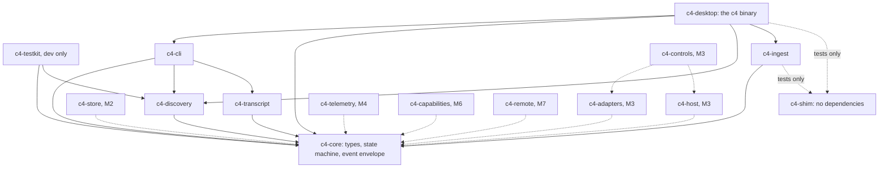
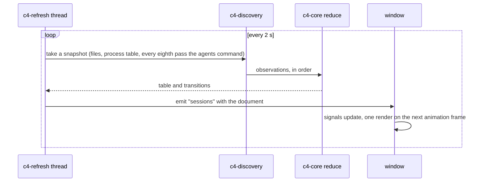
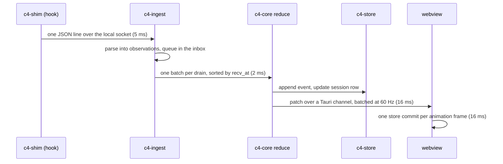
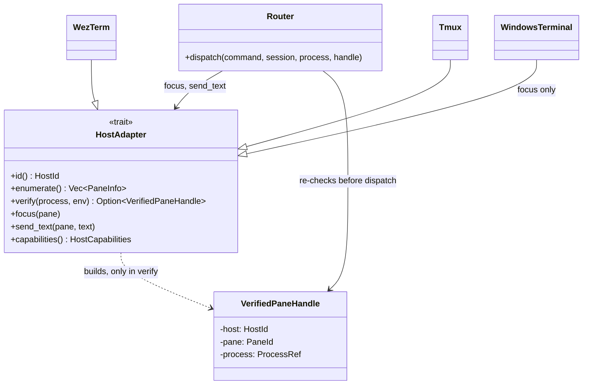

<!-- <wtl> project: c4 | file: docs/ARCHITECTURE.md | author: watchthelight </wtl> -->

# Architecture

C4 is a Rust core with a Tauri 2 shell. The core discovers sessions, tails transcripts, ingests hook
and status line payloads, reduces everything into typed session views and persists them in SQLite. The
shell renders those views with vanilla TypeScript and hosts xterm.js panes whose bytes come straight
from a per-session host process.

Status: Milestone 1 delivers `c4-core`, `c4-discovery`, `c4-transcript` (tailer, parser, follower,
index and watcher), `c4-testkit`, `c4-cli` and `c4-desktop`, whose window lists sessions. Milestone 2
has so far added `c4-shim`, `c4-ingest`, `Discovery::fold`, `c4 install` and `c4 uninstall`, the
app's ingest worker, which runs the server and folds its lines, and the preferences file under the C4
home with the two commands that read and write it. The other crates are named below with
the milestone that brings them; solid edges in the crate graph are in the tree, dotted ones are
planned.

## Processes

| Process | Role | Since |
|---|---|---|
| `c4` | The desktop app. With no arguments it opens the window; with arguments it runs a headless command (`sessions`, `doctor`, `telemetry`, `install`, `uninstall` today; `perf` and `host` with their milestones) and exits before any webview exists. | 1 |
| `c4-cli` | The same commands as a webview-free executable for development (`cargo run -p c4-cli -- sessions`). Not shipped. | 1 |
| `c4-shim` | A standard-library-only sidecar. `c4-shim statusline -- <original command>` starts the original command at once with the same stdin and copies the payload to C4's local socket on a thread beside it (spooled to disk when nothing listens), passing output and exit code through. `c4-shim hook` does the same copy and always exits 0 with empty output, 900 ms after reading the payload at the latest. The status line pays the shim's own startup and nothing else. It ships beside `c4` as a Tauri sidecar (docs/BUILDING.md), which is where `c4 install` takes its copy from. | 2 |
| `c4 host --session <id>` | One detached process per managed session. It owns the pty, a 2 MiB raw ring buffer, a screen model, the controller lease and a local socket. The UI can crash or exit and the host keeps the session alive. | 3 |
| `python -I hooks/c4_usage.py` | On demand: imports the user's `statusline.py` and prints its `parse_usage()` result as JSON for sessions whose status line has not run recently. | 4 |

## Crates



| Crate | Responsibility | Milestone |
|---|---|---|
| `c4-core` | `SessionId`, `ProcessRef {pid, proc_start}`, `Evidence {source, observed or heuristic, at}`, the nine-state `SessionState`, `Observation` (registry, agents command, daemon, process, transcript, hook, OSC, status line), `SessionView`, `SessionTable`, `reduce` with its rules, the versioned event `Envelope`, `redact`, and `home` (where C4 keeps its own files and how its ingest endpoint is named). No I/O. | 1, 2 |
| `c4-discovery` | `ClaudeHome` resolution (`C4_CLAUDE_HOME`, `CLAUDE_CONFIG_DIR`, `~/.claude`), the registry reader, the `claude agents --json` runner with a timed capture, daemon and job enrichment with the auth fields dropped, the process probe (sysinfo) with the liveness ladder (pid, creation time, executable name), terminal host identification from the process environment, the transcript existence check, and `Discovery`, which folds one pass into the table and reports the transitions, and whose `fold` applies observations from outside a pass (the hook events and status line payloads the ingest server parses) in stamp order. | 1, 2 (`fold`) |
| `c4-transcript` | The byte-offset tailer, the tolerant record parser gated on the major `version`, the record-to-event map, the subagent and workflow directory scanner, the project index built from metadata only, `SessionFollower` (one session's main transcript and agent files, folded into observations, usage max-merged per message id) and the file watcher. The workflow graph comes in Milestone 5. | 1 (reader), 5 (graph) |
| `c4-testkit` | `ScratchHome` (a Claude home in a temp dir, seeded from `fixtures/home`), `FakeClaude` (a real process registered with its pid and creation time, so liveness tests run on a real process table), the discovery tests A and B. | 1 |
| `c4-cli` | `c4 sessions [--json|--watch|--files-only|--redact|--home]`, `c4 doctor [--json|--no-commands|--c4-home]`, `c4 telemetry --transcript <file> [--json]`, `c4 install [--dry-run|--home|--c4-home|--shim]` and `c4 uninstall [--dry-run]`. The last two are the one writer of a Claude home: the shim copy, the status line wrapper and the hook groups, every write of `settings.json` after a backup beside it and recorded in a manifest under the C4 home for the way back (docs/SESSION-INTEGRATION.md). `doctor` audits that install as well: the shim copy against the manifest and the sidecar, the hook groups and the wrapper as `settings.json` holds them now, the ingest endpoint and the spool. JSON output carries `schema: 1`. Exit 0, 1 (could not do the job, reason on stderr) or 2 (usage). | 1, 2 |
| `c4-desktop` | The Tauri app: the refresh thread, the ingest worker (the server on a tokio runtime of its own and the drain that folds its lines), two commands, one event, the Windows console attach for headless use. The window itself is `apps/desktop/src`. | 1, 2 |
| `c4-ingest` | The receiving end of the shim: a server on the home's ingest endpoint (a named pipe whose DACL admits the current user alone on Windows; a socket file with mode 0600 elsewhere, every peer's uid checked against the owner of the home), the parser that turns each line into an `Identity` observation plus the `Hook` or `Statusline` fact, a bounded inbox that drops its oldest item and counts the drop rather than hold up a hook, the spool replay at start and every 30 s, and a standard-library probe for `c4 doctor`. A line over 2 MiB or a connection silent for 5 s is dropped and counted; a line the parser refuses is logged by size and reason, never by content. A second server on the same home is refused. Its end-to-end test sends lines through `c4-shim`'s own delivery code. | 2 |
| `c4-store` | SQLite schema and queries: sessions, identities, events, cursors, usage samples, agents, tasks, config transactions, audit, hosts, layouts, searchable scrollback. | 2 |
| `c4-shim` | The sidecar: the `statusline -- <command>` and `hook` subcommands, the one-line JSON envelope, the endpoint rule (repeated from `c4-core::home` and held equal by a test), the spool and the run log. Standard library only. docs/SESSION-INTEGRATION.md has the wire format. | 2 |
| `c4-adapters` | The `HostAdapter` trait and one implementation per terminal host. | 3, 7 |
| `c4-host` | The managed session host: pty, ring buffer, screen model, lease, socket framing. | 3 |
| `c4-controls` | The command router: target validation, leases, the audit log. | 3 |
| `c4-telemetry` | Status line payload ingest, the status line's cache file readers, cost and ledger readers, the quota model with explicit unknowns, the `c4_usage.py` bridge. | 4 |
| `c4-capabilities` | The library model, toolkits, config transactions with backups and inverse operations, redaction. | 6 |
| `c4-remote` | Pairing and an encrypted transport for paired hosts. Off by default. | 7 |

## The desktop app

`apps/desktop/src-tauri` is the `c4-desktop` crate and builds the `c4` executable. `main.rs` looks at
the command line first: any argument means a headless command, so it attaches to the parent console
on Windows (a release `c4` is a windowed executable) and hands over to `c4_cli::main()`, and no
webview is ever created. With no arguments `c4_desktop::run()` builds the Tauri app.

The app state is one `Discovery` behind a mutex, shared by the refresh thread and the commands. The
refresh thread (`c4-refresh`) runs a pass every `C4_REFRESH_MS` milliseconds (2000 by default, floor
250): the registry files, the daemon files, the process table and the transcript check. Every eighth
pass also runs the session list command, because it starts a Node process and, on macOS and Linux, can
revive Claude Code's background supervisor as a side effect. After each pass the thread emits the
`sessions` event with the document below. The mutex serializes a pass with a `list_sessions` call and
with a fold of ingested lines, so the table is never read half-updated.

The ingest worker (`ingest.rs`) starts after the Tauri app is built and before its event loop runs.
It owns a tokio runtime of two threads named `c4-ingest`, on which the `c4-ingest` server listens on
the C4 home's endpoint, replays the spool and serves the shim's connections. A drain task takes the
parsed lines from the inbox as they arrive and hands each batch to `AppState::fold` on a blocking
thread of that runtime, which takes the same mutex as a pass, folds the observations in `recv_at`
order (`Discovery::fold`) and emits the `sessions` event with the document; batches are at least
40 ms apart, so a burst of hooks is one event. A line whose `agent_id` is set came from inside a
subagent and folds its identity only, because a subagent's tool calls must not move the session.
When another C4 holds the endpoint, or the server cannot start, the worker records the state and the
error for the document and tries again every 15 s. On `RunEvent::Exit` the app stops the worker,
which shuts the server down (the socket file is removed on Unix) and waits up to 2 s for it; a stop
that takes longer is logged and not waited on. The runtime lives only while the worker does; the
refresh thread and the commands never touch tokio. A worker that cannot get a runtime is reported on
stderr and the window runs without hooks.

| Call | Direction | Payload |
|---|---|---|
| `list_sessions` | window to core (invoke) | runs one files-only pass and returns the document |
| `about` | window to core (invoke) | C4 version, the Claude home and what chose it, the C4 home and what chose it, the ingest endpoint, the preferences file and what was wrong with it at startup if anything, refresh period, agents cadence, operating system |
| `prefs_get` | window to core (invoke) | the preferences document as the core holds it |
| `prefs_set` | window to core (invoke) | `section`, `value`: replaces one section, writes the file, returns the document as written; an error string when the name is not a section name, the result would pass 1 MiB or the write failed |
| `sessions` | core to window (event) | the document, after every pass and after every batch of ingested lines |

The document is what `c4 sessions --json` prints (`schema`, `at`, `home`, `sessions[]`, `report`)
plus `tick` (the pass counter), `agents` (when the session list command last ran, how many entries it
returned or why it failed), `transitions[]` (session, from, to, the state text and the evidence of
every state change in the pass or the batch) and `ingest` (the server's state and endpoint, its
counts of connections, lines, replayed lines, drops, folded observations and subagent lines, and when
the last line arrived). `apps/desktop/src/bridge/types.ts` mirrors every shape.

The window is TypeScript without a framework. It reads the preferences first and builds the sidebar
from them (`apps/desktop/src/prefs.ts`; a core that cannot give them yields the defaults and a note
in the status strip). Five signals (`snapshot`, `about`, `selected`, `note` for a preferences
problem of this run, a one-second `clock`) feed one render per animation frame; nothing renders
while the window is hidden. Every change by hand in the sidebar (a pin, the grouping, a folded
group, the density, the splitter) goes to a store that writes the `sidebar` section a quarter of a
second after the last change, one write in flight at a time, and flushes on `pagehide`.
`selectBridge()` picks the Tauri bridge when the page runs inside the app and the mock bridge (eight
synthetic sessions on a scripted timeline) in a plain browser, so the layout can be worked on and
tested without Claude Code; `VITE_C4_BRIDGE=mock|tauri` forces either. `fixtures/labels.json` is the
label contract: the Rust side and the TypeScript side are both tested against it, so the window never
shows a state label the command line would contradict.

Capabilities: the window runs with Tauri's `core:default` capability only; the four commands above
are the whole surface. The content security policy allows `self` and inline styles and nothing remote.

## Event flow

Today:



Hook and status line payloads join through the shim and the ingest server. The server, the parser, the
inbox and the fold into the table (`Discovery::fold`, a stable sort by `recv_at` and then the
reducer) are in the tree and the app runs them. The store and the channel patches in the sequence
below are still to come: today the whole document goes to the window as the `sessions` event after
each batch, at most one every 40 ms:



Budget from hook event to pixels: 150 ms at the 95th percentile. Terminal bytes (Milestone 3) do not
take this path. The host coalesces pty output into frames of at most 64 KiB every 8 to 16 ms, allows
two frames in flight per terminal, and sends them as raw bytes over a Tauri channel straight to
`xterm.write`. The host never stops draining the child process; a slow or reconnecting UI gets a
screen snapshot plus the tail of the ring buffer.

## Threads and errors

The CLI is synchronous on the main thread: a command is one pass or one file read, then exit. The app
has the Tauri event loop on the main thread, the `c4-refresh` thread, and whatever threads the
webview brings. `c4-ingest` brings tokio: the app's ingest worker owns a runtime of two threads named
`c4-ingest` that run the accept task, one task per connection, the replay timer, the drain, and on
blocking threads the spool reads and the folds into the table. Nothing else in the app is
asynchronous. The process probe keeps its own system snapshot and refreshes only the pids it is
asked about.

A file discovery cannot use becomes a `Problem` (path and reason) in the pass report, never an error
that stops the pass, because one broken file must not hide the sessions around it. The window shows
the count in its status strip; `c4 sessions --json` lists them under `report.problems`. The CLI's
exit codes are 0, 1 (the reason on stderr) and 2 (usage). Logging is `tracing`; `--log <filter>`
turns it on for a command, to stderr. Log lines never carry a prompt, a token or a key.

## HostAdapter (Milestone 3)

```rust
pub trait HostAdapter {
    fn id(&self) -> HostId;
    fn enumerate(&self) -> Result<Vec<PaneInfo>>;
    fn verify(&self, process: &ProcessRef, env: &ProcessEnv) -> Option<VerifiedPaneHandle>;
    fn focus(&self, pane: &VerifiedPaneHandle) -> Result<()>;
    fn send_text(&self, pane: &VerifiedPaneHandle, text: &str) -> Result<()>;
    fn capabilities(&self) -> HostCapabilities; // focus only, or focus and send
}
```



`VerifiedPaneHandle` has no public constructor. Only `verify` builds one, and only from a match
between the Claude Code process and a pane the host enumerated. The router re-checks the process
(pid and creation time) and the handle before every dispatch. Today's `HostKind` and `Attachment`
in `c4-core` already carry which hosts can take input, so the window labels every session Observed
or Disconnected and draws no input control.

## Store

What is kept between runs today is `prefs.json` under the C4 home
(`apps/desktop/src-tauri/src/prefs.rs`): one JSON object with `schema` 1 and one section per part
of the window, `sidebar` today (`density`, `group_by`, `pinned`, `collapsed`, `width`). The core
treats a section as opaque JSON: `prefs_set` replaces one, refuses a result over 1 MiB, writes
`prefs.json.tmp` (0600 on Unix, the directory 0700 when it creates it) and renames it over the file,
with three tries for the rename on Windows. At startup a file that is not a JSON object, or is over
the cap, is renamed to `prefs.json.bad-<stamp>`, the window starts from an empty document and
`about` carries the problem for the status strip. A section or a `schema` number another version
wrote is kept as it is. The window owns each section's shape and reads it one value at a time with
a default for whatever is missing or malformed. The session table is not persisted: every start of
the window begins with an empty table and a fresh pass.

SQLite through rusqlite (Milestone 3 onwards) with the bundled engine, WAL mode and FTS5. Tables:
`sessions`, `identities` (pid and creation time history per session), `events` (append-only,
per-session sequence), `cursors` (transcript path, byte offset, size, last record uuid),
`usage_samples`, `agents`, `tasks`, `config_tx`, `audit`, `hosts`, `layouts`, `scrollback` (FTS5).
Retention by age and row count with a vacuum job. The file will live under `~/.c4/` beside
`prefs.json` and can be opened with any SQLite tool.

## Performance budgets

| Stage | Budget | Measured |
|---|---|---|
| Cold start to the first session list | 2 s | 37 ms for the window's first pass over a real home with four sessions; 611 ms for `c4 sessions` with the session list command (Windows, see docs/VERIFICATION.md) |
| Hook event to UI | 150 ms p95 | the path is in the tree; not measured yet (`c4 perf`, Milestone 7) |
| Transcript append to graph update | 500 ms | Milestone 5 |
| Pty frames | 8 to 16 ms, two in flight | Milestone 3 |
| Memory | 8 MiB of core per session plus xterm scrollback; under 400 MiB RSS at 30 sessions | Milestone 7 |
| Idle CPU | under 1 %: no poll faster than 2 s, animation paused when hidden | Milestone 7 |

`c4 perf` (Milestone 7) prints p50 and p95 per stage from tracing spans; criterion benches cover the
parsers; a soak test pushes 3,000 events per minute from 40 synthetic sessions through the real shim
path.
