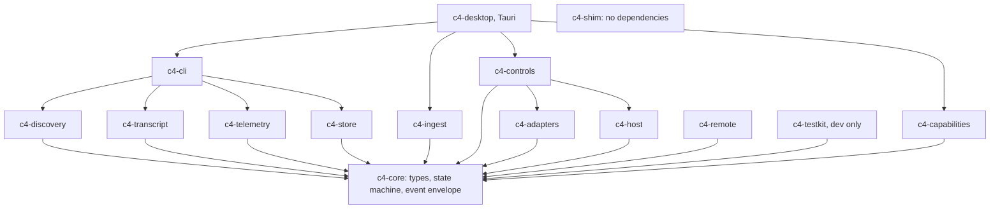
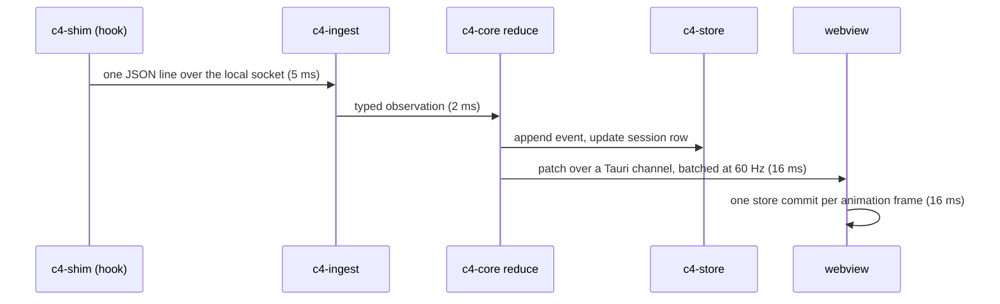

<!-- <wtl> project: c4 | file: docs/ARCHITECTURE.md | author: watchthelight </wtl> -->

# Architecture

C4 is a Rust core with a Tauri 2 shell. The core discovers sessions, tails transcripts, ingests hook
and status line payloads, reduces everything into typed session views and persists them in SQLite. The
shell renders those views with vanilla TypeScript and hosts xterm.js panes whose bytes come straight
from a per-session host process.

Status: Milestone 1 delivers `c4-core`, `c4-discovery`, `c4-transcript` (index only), `c4-testkit`,
the CLI and a Tauri shell that lists sessions. Later milestones add the crates named below; the crate
table says which milestone each one belongs to.

## Processes

| Process | Role |
|---|---|
| `c4` | The desktop app. The same binary runs headless subcommands (`sessions --json`, `telemetry`, `perf`, `install`, `uninstall`, `doctor`, `host`) which branch before any window is created. |
| `c4-shim` | A standard-library-only sidecar. `c4-shim statusline -- <original command>` copies stdin to C4's local socket (20 ms connect timeout, spool to disk on failure) and then runs the original command with the same stdin, passing its output and exit code through. `c4-shim hook` does the same tee and always exits 0 with empty output. About 2 ms of overhead. |
| `c4 host --session <id>` | One detached process per managed session. It owns the pty, a 2 MiB raw ring buffer, a screen model, the controller lease and a local socket. The UI can crash or exit and the host keeps the session alive. |
| `python -I hooks/c4_usage.py` | On demand: imports the user's `statusline.py` and prints its `parse_usage()` result as JSON for sessions whose status line has not run recently. |

## Crates



| Crate | Responsibility | Milestone |
|---|---|---|
| `c4-core` | `SessionId`, `ProcessRef {pid, proc_start}`, `Evidence {source, observed or heuristic, at}`, the state enum, the versioned event envelope, `reduce`. No I/O. | 1 |
| `c4-discovery` | Registry reader, `claude agents --json` poller, daemon enrichment (auth fields dropped), process scan and parent chains, transcript index (metadata only), identity reconciliation, liveness and pid-reuse checks, terminal host identification from the process environment. | 1 |
| `c4-transcript` | Incremental JSONL tailer from stored byte offsets, tolerant record parser gated on the `version` field, subagent and workflow directory scanner, workflow graph and timeline model. | 1 (index), 5 (graph) |
| `c4-telemetry` | Status line payload ingest, the status line's cache file readers, cost and ledger readers, the quota model with explicit unknowns, the `c4_usage.py` bridge. | 4 |
| `c4-ingest` | Local socket server (named pipe with a current-user DACL on Windows, mode 0600 Unix socket elsewhere), spool replay, bounded queues that drop the oldest item and count drops instead of blocking a producer. | 2 |
| `c4-adapters` | The `HostAdapter` trait and one implementation per terminal host. | 3, 7 |
| `c4-host` | The managed session host: pty, ring buffer, screen model, lease, socket framing. | 3 |
| `c4-controls` | The command router: target validation, leases, the audit log. | 3 |
| `c4-capabilities` | The library model, toolkits, config transactions with backups and inverse operations, redaction. | 6 |
| `c4-store` | SQLite schema and queries: sessions, identities, events, cursors, usage samples, agents, tasks, config transactions, audit, hosts, layouts, searchable scrollback. | 1 |
| `c4-remote` | Pairing and an encrypted transport for paired hosts. Off by default. | 7 |
| `c4-shim` | The sidecar. | 2 |
| `c4-cli` | The headless subcommands. | 1 |
| `c4-testkit` | Fixture builders, a scratch Claude home, the fake Claude Code driver. | 1 |
| `c4-desktop` | Tauri commands, channels, windows, tray. | 1 |

## Event flow



Budget from hook event to pixels: 150 ms at the 95th percentile. Terminal bytes do not take this
path. The host coalesces pty output into frames of at most 64 KiB every 8 to 16 ms, allows two frames
in flight per terminal, and sends them as raw bytes over a Tauri channel straight to `xterm.write`.
The host never stops draining the child process; a slow or reconnecting UI gets a screen snapshot
plus the tail of the ring buffer.

## HostAdapter

```rust
pub trait HostAdapter {
    fn id(&self) -> HostId;
    fn enumerate(&self) -> Result<Vec<PaneInfo>>;
    fn verify(&self, process: &ProcessRef, env: &ProcessEnv) -> Option<VerifiedPaneHandle>;
    fn focus(&self, pane: &VerifiedPaneHandle) -> Result<()>;
    fn send_text(&self, pane: &VerifiedPaneHandle, text: &str) -> Result<()>;
    fn capabilities(&self) -> HostCapabilities; // focus only, or focus and send
}
```

`VerifiedPaneHandle` has no public constructor. Only `verify` builds one, and only from a match
between the Claude Code process and a pane the host enumerated. The router re-checks the process
(pid and creation time) and the handle before every dispatch.

## Store

SQLite through rusqlite with the bundled engine, WAL mode and FTS5. Tables: `sessions`, `identities`
(pid and creation time history per session), `events` (append-only, per-session sequence),
`cursors` (transcript path, byte offset, size, last record uuid), `usage_samples`, `agents`, `tasks`,
`config_tx`, `audit`, `hosts`, `layouts`, `scrollback` (FTS5). Retention by age and row count with a
vacuum job. The file lives under `~/.c4/` and can be opened with any SQLite tool.

## Performance budgets

| Stage | Budget |
|---|---|
| Cold start to the first session list | 2 s |
| Hook event to UI | 150 ms p95 |
| Transcript append to graph update | 500 ms |
| Pty frames | 8 to 16 ms, two in flight |
| Memory | 8 MiB of core per session plus xterm scrollback; under 400 MiB RSS at 30 sessions |
| Idle CPU | under 1 %: no poll faster than 5 s, animation paused when hidden |

`c4 perf` prints p50 and p95 per stage from tracing spans; criterion benches cover the parsers; a soak
test pushes 3,000 events per minute from 40 synthetic sessions through the real shim path.
