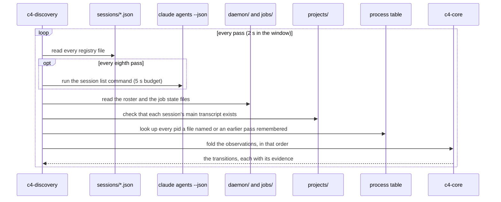
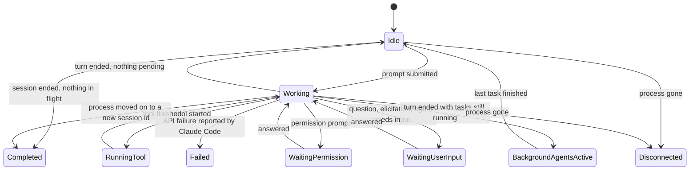

<!-- <wtl> project: c4 | file: docs/HOW-IT-WORKS.md | author: watchthelight </wtl> -->

# How C4 works

C4 does not talk to Claude Code through a private API. It reads the files Claude Code already writes,
runs the commands Claude Code already documents, and hosts terminals of its own. This page explains
what those sources are, how sessions are found and identified, how the sidebar decides what state a
session is in, and what C4 never reads.

Status: Milestone 1 is in the tree. That is the discovery pass over the registry, the session list
command, the supervisor files and the process table; the state machine with its evidence; the
transcript reader, which `c4 telemetry` uses today; the headless commands; and a window that lists
sessions. Milestone 2 has so far added live states from hooks and the status line: the shim, the
ingest server the window runs, and `c4 install`. Managed terminals come in Milestone 3, telemetry in
Milestone 4 and the workflow graph in Milestone 5. Each row and section below says which.
docs/VERIFICATION.md records what has been verified where.

## What C4 reads

| Source | What it tells C4 | How it is read | Since |
|---|---|---|---|
| `~/.claude/sessions/<pid>.json` | One file per running Claude Code process: pid, session id, cwd, start time, process creation time, name and where the name came from, status (`busy`, `idle`, `waiting`) and what it waits for, the peer-message socket path. | Read on every refresh pass: every 2 s in the window, once per `c4 sessions`, every second under `--watch`. Unknown fields are ignored; a file that does not parse is listed as a problem and skipped. The sibling `<pid>.<hash>.key` file is a secret: the scanner counts it as skipped and never opens it. | 1 |
| `claude agents --json` | The list Claude Code itself keeps of interactive and background sessions, with status and `waitingFor`. | Run on every eighth pass in the window (16 s at the default period) and once per `c4 sessions` unless `--files-only`, with a 5 s budget. It starts a Node process and, on macOS and Linux, can revive Claude Code's background supervisor, which is why the window runs it less often than it reads the files. Entries can outlive their process, so C4 checks liveness itself. `C4_AGENTS_CMD` substitutes another command; the tests point it at a script that prints fixtures. | 1 |
| The process table | Whether the pid a file names is still the same process, and which terminal it runs in. | One lookup per pid per pass, never a scan of every process. A pid that is gone is gone. A pid that exists is the same process when its creation time matches the registry's `procStart` within 2 s; a different creation time is a reused pid. When no creation time can be compared (the session list command gives none), the process counts as alive but unverified if its executable is named like Claude Code (`claude`, `node`, `bun`), else as reused. The environment of a live process is read for the terminal variables listed below and nothing else. | 1 |
| `~/.claude/daemon/` and `jobs/` | Background session supervisor state: workers with their pids, each job's state, what a blocked job needs, how much work it counts as in flight. | Read on every pass, with the auth fields dropped before anything is deserialized. The format is undocumented, so every field is optional in the parser. | 1 |
| `~/.claude/projects/<encoded cwd>/<session id>.jsonl` and its `subagents/` folder | The transcript: prompts, tool calls, tool results, model usage, compactions, turn boundaries, subagent and workflow launches. | Discovery only checks that the main transcript exists where the cwd says it should, and records the path. `c4 telemetry --transcript <file>` reads one file through the tailer and the follower: byte offsets, a partial last line ignored, usage max-merged per message id, one entry per agent file. The window does not follow transcripts yet. | 1 (reader), 4 and 5 (window) |
| The status line payload | Context window usage, rate limits, cost, model, prompt cache, effort, session name. | A tiny shim (`c4-shim`) wrapped around the existing status line command copies the payload to C4 and runs the original command unchanged; the window folds each payload into the table as it arrives. | 2 |
| Hook events | Turn start and end, tool start and end, permission and input prompts, subagent start and end, compaction, cwd and config changes, session end. | Async command hooks that `c4 install` adds to `~/.claude/settings.json`. They print nothing and exit 0, so they can never block Claude Code. Claude Code applies a hook added to a settings file to sessions that are already running (tested with 2.1.299 and a project settings file; docs/SESSION-INTEGRATION.md has the details). The window starts the ingest server that receives them when it opens and folds each event into the table as it arrives; what arrived while no C4 ran is replayed from the spool at the next start. | 2 |
| OSC 7501 and OSC 21337 | Claude Code's own terminal status protocol (`working`, `blocked`, `done`, `error`, `idle`). | C4's terminal panes answer the protocol's query, so a session running inside C4 reports its state with nothing installed. | 3 |
| The status line's own cache files | Per-session token accounting and the quota cache that `statusline.py` maintains. | Read as they are. C4 reproduces none of that accounting; it shows the same numbers the status line shows. | 4 |

### Which terminal a session runs in

The terminal is read from the environment of the Claude Code process, which inherits it from the
shell that started it. The first match wins.

| Variables | Host | Pane id C4 keeps |
|---|---|---|
| `TMUX_PANE`, else `TMUX` | tmux | the pane, such as `%3` |
| `WEZTERM_PANE` | WezTerm | the pane id |
| `ITERM_SESSION_ID` | iTerm2 | the session id |
| `KITTY_WINDOW_ID` | kitty | the window id |
| `WT_SESSION` | Windows Terminal | the session guid, which no public command addresses a tab by |
| `VSCODE_PID`, `VSCODE_INJECTION` or `TERM_PROGRAM=vscode` | VS Code | none |
| `ALACRITTY_WINDOW_ID` | Alacritty | the window id |
| `TERM_PROGRAM` of `WezTerm`, `iTerm.app`, `Apple_Terminal`, `Alacritty` or `tmux` | that host | `TERM_SESSION_ID` for Terminal.app |
| `GNOME_TERMINAL_SCREEN` or `VTE_VERSION` | GNOME Terminal | none |
| `ComSpec` and `SESSIONNAME` with none of the above | a plain Windows console | none |
| nothing recognized | unknown | none |

Every session found this way is labeled Observed. Whether a host can take input is a property of
the host, decided in Milestone 3; no session takes input today.

## How sessions are found

One refresh pass, in the order its facts are applied:

Identity is the session id. The registry entry fills the process, cwd, name, version and socket
first; the session list command and the supervisor files add what the registry did not have; the
transcript path is derived from the cwd and recorded only when the file is there. The hook and
status line payloads join by the session id they carry, folded into the same table between passes
in the order the shim received them.

A pass remembers every live process from the pass before, so a session whose registry file vanished
is still looked up until its process is gone. One lookup per pid serves every session that names it,
and each session gets its own verdict:

- The pid is gone: the session is Disconnected (process gone).
- The pid exists but its creation time or executable name says it is another program: a reused
  pid, also Disconnected (pid reused). The registry file is Claude Code's and is left alone either
  way.
- The pid exists and matches, but a file now names another session id for it: `/clear` or
  `/resume` ended the old conversation and started a new one in the same process. The old session
  is Completed (continued in the new id) and is not looked up again; the new one takes over the
  process and its terminal.
- The pid exists and matches a session no file names any more: nothing changes until the process
  exits.

A background worker whose process is gone while its job sits at Done stays as it is: the supervisor
parks idle workers, and a parked worker is not a broken one. Two live processes on one session id (a
resume in two terminals) are not told apart yet; the view carries the process named last, and C4
never resolves that by killing anything.

Historical transcript files are never treated as live sessions. Discovery does not read the
transcript directories at all; the project index that lists old transcripts belongs to the resume
picker of a later milestone.

## How a session is attached

| Mode | When | What C4 can do | Since |
|---|---|---|---|
| Observed | The session runs in a terminal with no control surface, or the pane could not be verified; today, every live session | Show everything C4 reads, focus the window (Milestone 3), send a peer message through Claude Code's own messaging socket (Milestone 3; labeled as a message, never typed as keyboard input) | 1 |
| Disconnected | The process is gone; today, every dead session | Show the last known state and offer to resume the session as a managed one (Milestone 3) | 1 |
| Managed | C4 started the session in its own terminal host | Everything: read the screen, type, interrupt, terminate (after confirmation) | 3 |
| Interactive Attached | The session runs in a terminal with a verified control surface (WezTerm, tmux, iTerm2, kitty) and C4 matched the exact pane | Focus the pane, send text to it, read what the host exposes | 3 |

Verification is literal: a send operation takes a handle that can only be built from a match between
the Claude Code process and the pane (its pid ancestry or its tty). No function in C4 accepts a raw pid
or window handle for input, and C4 never injects input into a process it does not own.

## How a session's state is decided

Every transition comes from an observed input: a registry status, a session list entry, a
supervisor job state, a liveness check, a hook event or a status line payload, and later an OSC
report (Milestone 3) or a transcript record (Milestone 5). What each source says today:

| Input | Transition |
|---|---|
| Registry `status` `busy` | Working, or Running a tool when a tool is known to be open |
| Registry `status` `idle` | Idle, or Background agents active when work is known to be in flight |
| Registry `status` `waiting` with `waitingFor` | Waiting for permission when the text starts with `approve` or mentions a permission, a sandbox or a worker request; otherwise Waiting for user input, as a question for `input`, a dialog for `dialog` |
| `claude agents --json` interactive `status` and `waitingFor` | the same mapping |
| `claude agents --json` background `state`, and the supervisor's job state | `working` is Working; `blocked` is Waiting, with the job's `needs` text deciding permission or input; `done` is Idle; `failed` is Failed; `stopped` is Completed |
| Process lookup | Disconnected (process gone or pid reused), or Completed (continued in a new session id) |
| Hook `UserPromptSubmit`, `PreCompact` | Working |
| Hook `PreToolUse`, then `PostToolUse` or `PostToolUseFailure` | Running a tool, named, then Working |
| Hook `Notification` | Waiting for permission for `permission_prompt` (and the worker form of it), naming the open tool; Waiting for user input for `elicitation_dialog` and `agent_needs_input`; `idle_prompt` confirms the rest state (Idle, or Background agents active while work is in flight); an elicitation or auth that completes takes a waiting session back to busy |
| Hook `Stop` | Background agents active when the payload lists tasks still running, else Idle |
| Hook `SubagentStart`, `SubagentStop`, `TaskCreated`, `TaskCompleted` | The agent and task lists; a stop or completion moves the session only out of Background agents active |
| Hook `StopFailure` | Failed, with Claude Code's error |
| Hook `SessionEnd` | Completed with the reason; a session that still has work in flight stays Background agents active unless the reason is `clear` or `resume` |
| Hook `PostCompact`, `CwdChanged`, `ConfigChange` | The compaction count, the cwd, nothing |
| A hook fired inside a subagent | Nothing but the session's identity; the subagent's own tool calls never move the session |
| A status line payload | Nothing; it carries the model, the context figures and the effort, and proves the process is alive |
| The clock | A session busy for ten minutes with no new fact gets a "stalled?" badge and nothing else |

The rules that keep the sidebar honest:

1. Failed never comes from silence. Only Claude Code's own failure report, a background job in state
   `failed`, a non-zero exit of a managed child, or an exhausted API retry produce it. A session that
   has been Working for ten minutes without new data gets a small "stalled?" badge and nothing else.
2. Completed requires a session end or a process exit, and no known in-flight background tasks,
   subagents or daemon workers. A session with background agents still running is shown as
   Background agents active, not Completed.
3. A guess never overrides an observed fact that is less than 30 s old, and a fact stamped earlier
   than what the view already knows is dropped (with 1 s of tolerance for clocks that disagree).
4. Sessions without hook telemetry run on the registry status, the transcript and the status line's
   cache alone and are marked "coarse". That is every session until its first hook event arrives
   through the shim that `c4 install` wires in.

Every transition carries its evidence: the source and whether the fact was observed or guessed. The
window and `c4 sessions` print guesses with a `~` in front of the state.

## The window today

`c4` with no arguments opens one window. Its sidebar lists every session discovery can see, in
attention order (the waiting states first, then failed and disconnected, then running, then idle and
completed), pinned sessions ahead of the rest. The list is virtual: only the rows near the viewport
exist, so a thousand sessions scroll like twenty. Each row shows the state square and the state
text (a `~` in front of a guess), the context figure from the status line with a small bar, how long
the session has been in its state, and its host, attachment and pid; the third line of an expanded
row adds the attachment chip, the model and effort, and the cwd. Three densities (22, 34 and 56px
rows) cycle on Ctrl+Shift+= (Cmd+Shift+= on macOS); the compact row keeps the state text in its
tooltip and its accessible name. The arrow, page, Home and End keys move the selection and scroll
to it; `p` pins the selected session, which lifts it to the top of the list, or of its group.

The list groups by project, host or state (the button above it, or `g` in the list). Each group
gets a 24px header with its number, its name, how many sessions it holds and how many need you;
groups come in the order of their most urgent session. A click on the header, or Left on a selected
row, folds the group, and Right opens it again. The filter box above the list (`/` focuses it,
Escape clears it) narrows the list as you type: words match the name, the project and the cwd;
`state:`, `project:`, `tool:`, `mode:` and `host:` tokens match one field each, two values of one
key mean either, and tokens of different keys all have to hold. A row changes its glyph and text
the moment a fact arrives, but a reorder from the core waits while the pointer is inside the list
or the list has keyboard focus, and applies on leave or after two seconds at rest, so a row never
moves out from under a click. What you do by hand (filter, pin, fold, regroup) applies at once, and
a session that arrives while the order is held joins under its header. Resting the pointer on a row
for 350 ms opens a card beside it: the attachment and why (the host and pane, or what ended the
session), the state with its evidence, the model and effort, the context figure with its bar, the
open tool, the agents with the last three named, the cwd, and when the session started, last did
something and last sent a status line. The card takes no pointer events, follows the pointer from
row to row, and closes when the pointer leaves the rows, the list scrolls or a key is pressed, then
stays closed until the pointer moves again; the keyboard has the inspector. Tokens, the cache
ratio, the branch and the last tool calls join the
card when the telemetry and transcript readers land in Milestones 4 and 5. Selecting a row opens a
read-only inspector: the state with the source and time of its evidence, the process, cwd,
name, version, host, attachment, transcript path, agents and tasks as far as the files say. The
status strip shows when the last pass ran and how long it took, when the session list command last
ran and what it returned, how many files could not be read, the ingest server's state (how many
lines it has taken in, when the last one arrived, whether any were dropped, or that another C4 holds
the endpoint), and where the Claude home came from.

The splitter at the sidebar's right edge sets its width: drag it, or focus it and press Left or
Right for 10px, Home or End for the limits; a double-click puts the 320px default back. The sidebar
never goes under 220px and the workspace keeps 400px, so a narrower window shows less of the width
you set and a wider one gives it back.

Nothing in the window types into any session (the filter box narrows the list and reaches nothing
else). The sidebar's organization survives a restart: the pins, the grouping, the folded groups, the
density and the width go to `prefs.json` under the C4 home (`~/.c4/` unless `C4_HOME` or
`--c4-home` says otherwise) a quarter of a second after each change by hand (a change made in the
quarter second before the window closes may not reach the file), and the next start builds the
sidebar from them before the first pass. The file is one JSON object with a `schema`
number and one section per part of the window (`sidebar` today). The core keeps it whole and
replaces one section at a time through a temporary file and a rename; a section or a schema number
another version wrote survives. A file that is not a JSON object is moved aside as
`prefs.json.bad-<stamp>` and the status strip says so; a value the window does not understand falls
back to its default on its own, so a file from another version never stops the window. The table
of sessions is not kept: closing the window stops the ingest server, and the next start runs a
fresh pass and replays what the shim spooled in the meantime. `c4 sessions`, `c4 doctor` and
`c4 telemetry` print the same facts without a window; docs/BUILDING.md lists them.

## What C4 never reads

`~/.claude/.credentials.json`, the `sessions/*.key` files (except at the moment of a peer send, in a
buffer that is zeroed afterwards and never logged), the auth fields in the daemon files, IDE lock files
beyond their existence, any environment value whose name contains TOKEN, KEY or SECRET, and HTTP headers
in MCP server definitions. Those fields are dropped before any data structure exists, so they cannot
reach the store, the logs or an export. Today's readers also leave `~/.claude.json`, `history.jsonl`
and the ledger closed; the milestones that need them open them under the same rules. `settings.json`
is opened by `c4 install` and `c4 uninstall`, the one thing in C4 that writes it, after a backup and
with a manifest for the way back, and by `c4 doctor`, which reads it to count C4's own hook groups
and check the status line wrapper and reports nothing else from it (docs/SESSION-INTEGRATION.md).
docs/SECURITY.md has the full list.
