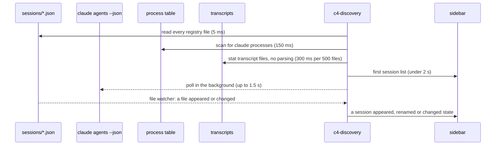
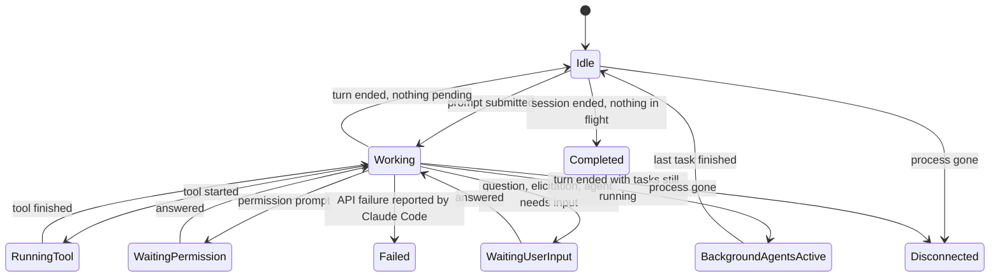

<!-- <wtl> project: c4 | file: docs/HOW-IT-WORKS.md | author: watchthelight </wtl> -->

# How C4 works

C4 does not talk to Claude Code through a private API. It reads the files Claude Code already writes,
runs the commands Claude Code already documents, and hosts terminals of its own. This page explains
what those sources are, how sessions are found and identified, how the sidebar decides what state a
session is in, and what C4 never reads.

Status: the discovery pipeline and the state machine land in Milestone 1; live states from hooks and
the status line in Milestone 2; managed terminals in Milestone 3. The sections below describe the
design that those milestones implement; docs/VERIFICATION.md records what has been verified where.

## What C4 reads

| Source | What it tells C4 | How it is read |
|---|---|---|
| `~/.claude/sessions/<pid>.json` | One file per running Claude Code process: pid, session id, cwd, start time, process creation time, name and where the name came from, status (`busy`, `idle`, `waiting`) and what it waits for, the peer-message socket path. | Watched with a file watcher; parsed with unknown fields ignored. The sibling `<pid>.<hash>.key` file is a secret and is never opened except at the moment a peer message is sent. |
| `claude agents --json` | The list Claude Code itself keeps of interactive and background sessions, with status and `waitingFor`. | Polled every 15 s off the critical path. Entries can outlive their process, so C4 checks liveness itself. |
| `~/.claude/projects/<encoded cwd>/<session id>.jsonl` and its `subagents/` folder | The transcript: prompts, tool calls, tool results, model usage, compactions, turn boundaries, subagent and workflow launches. | Tailed from a saved byte offset. C4 never rescans a whole transcript and ignores a partial last line. |
| The status line payload | Context window usage, rate limits, cost, model, prompt cache, effort, session name. | A tiny shim (`c4-shim`) wrapped around the existing status line command copies the payload to C4 and then runs the original command unchanged. |
| Hook events | Turn start and end, tool start and end, permission and input prompts, subagent start and end, compaction, cwd and config changes, session end. | Async command hooks that `c4 install` adds to `~/.claude/settings.json`. They print nothing and exit 0, so they can never block Claude Code. Claude Code applies a hook added to a settings file to sessions that are already running (tested with 2.1.299; docs/SESSION-INTEGRATION.md has the details). |
| OSC 7501 and OSC 21337 | Claude Code's own terminal status protocol (`working`, `blocked`, `done`, `error`, `idle`). | C4's terminal panes answer the protocol's query, so a session running inside C4 reports its state with nothing installed. |
| `~/.claude/daemon/` and `jobs/` | Background session supervisor state. | Read for enrichment only, with the auth fields dropped before anything is deserialized. This interface is unstable and C4 treats it as such. |
| The status line's own cache files | Per-session token accounting and the quota cache that `statusline.py` maintains. | Read as they are. C4 reproduces none of that accounting; it shows the same numbers the status line shows. |

## How sessions are found

Identity is the session id. A process is matched to it through the registry file first, then through
`claude agents --json`, then through hook and status line payloads (which carry the session id, the
transcript path and the cwd together), and only then through the transcript path derived from the cwd.
A process without a registry entry (older versions, `--bare`) is linked to a transcript modified in the
last 60 s under its project folder, and that link is labeled a guess.

A registry entry whose pid is dead becomes Disconnected; the identity is kept, the file is left alone
because it belongs to Claude Code. A pid that is alive but whose creation time or executable name does
not match is a reused pid and is also Disconnected. Two live processes on one session id (a resume in
two terminals) show a warning badge; C4 never resolves that by killing anything. When a session runs
`/clear` or `/resume` the process keeps its pid and gets a new session id; the `SessionEnd` and
`SessionStart` hooks re-identify it.

Historical transcript files are never treated as live sessions. A transcript with no process behind it
shows up only in the resume picker.

## How a session is attached

| Mode | When | What C4 can do |
|---|---|---|
| Managed | C4 started the session in its own terminal host | Everything: read the screen, type, interrupt, terminate (after confirmation) |
| Interactive Attached | The session runs in a terminal with a verified control surface (WezTerm, tmux, iTerm2, kitty) and C4 matched the exact pane | Focus the pane, send text to it, read what the host exposes |
| Observed | The session runs in a terminal with no control surface (Windows Terminal, VS Code, most others) or the pane could not be verified | Show everything C4 reads, focus the window, send a peer message through Claude Code's own messaging socket (labeled as a message, never typed as keyboard input) |
| Disconnected | The process is gone | Show the last known state and offer to resume the session as a managed one |

Verification is literal: a send operation takes a handle that can only be built from a match between
the Claude Code process and the pane (its pid ancestry or its tty). No function in C4 accepts a raw pid
or window handle for input, and C4 never injects input into a process it does not own.

## How a session's state is decided

Every transition comes from an observed input: a hook event, a registry status change, an OSC 7501
report, a transcript record, or a liveness check. The rules that keep the sidebar honest:

1. Failed never comes from silence. Only Claude Code's own failure report, a background job in state
   `failed`, a non-zero exit of a managed child, or an exhausted API retry produce it. A session that
   has been Working for ten minutes without new data gets a small "stalled?" badge and nothing else.
2. Completed requires a session end or a process exit, and no known in-flight background tasks,
   subagents or daemon workers. A session with background agents still running is shown as
   Background agents active, not Completed.
3. A guess never overrides an observed fact that is less than 30 s old.
4. Sessions without hook telemetry run on the registry status, the transcript and the status line's
   cache alone and are marked "coarse".

The UI shows which inputs a state came from. Observed facts are plain; guesses carry a `~` prefix.

## What C4 never reads

`~/.claude/.credentials.json`, the `sessions/*.key` files (except at the moment of a peer send, in a
buffer that is zeroed afterwards and never logged), the auth fields in the daemon files, IDE lock files
beyond their existence, any environment value whose name contains TOKEN, KEY or SECRET, and HTTP headers
in MCP server definitions. Those fields are dropped before any data structure exists, so they cannot
reach the store, the logs or an export. docs/SECURITY.md has the full list.
